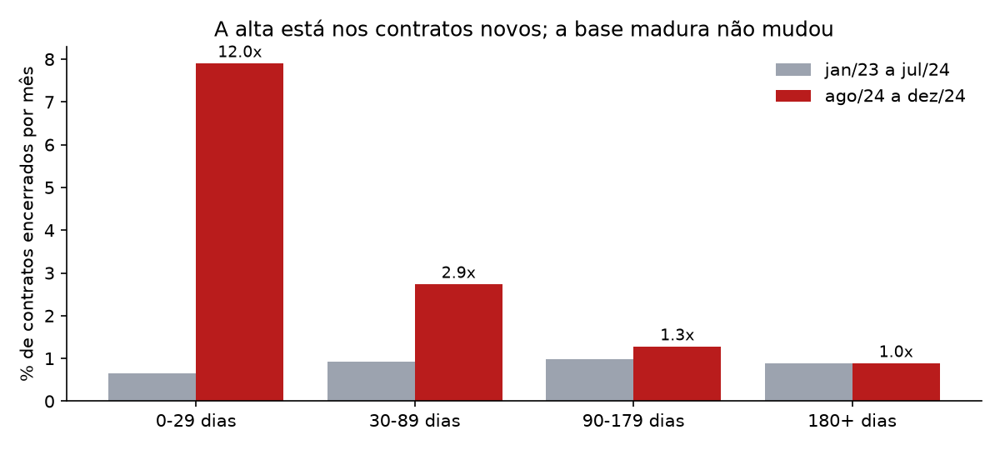
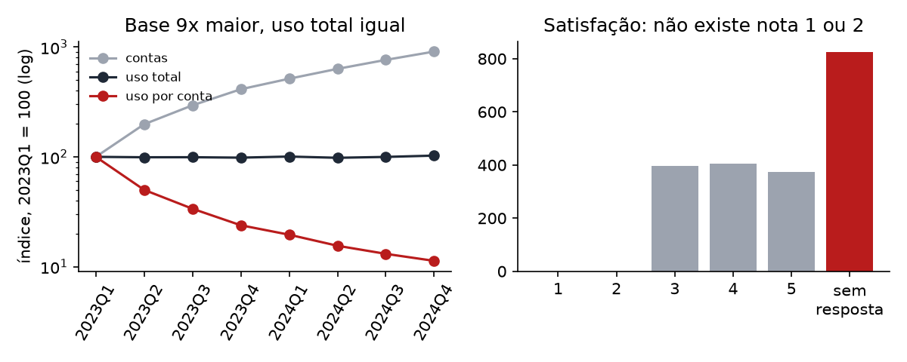

# Fase 2: diagnóstico

Script: [`solution/02_analysis.py`](../solution/02_analysis.py). As tabelas e os gráficos saem em `solution/output/`. Definição de churn: assinatura encerrada, medida em MRR (decisão 3 do [process log](../process-log/README.md)).

## O que está acontecendo

**O churn subiu, e a alta está toda nos contratos novos.** Desde agosto de 2024, uma assinatura com até 30 dias de vida encerra a 7,9% ao mês, contra 0,66% antes: 12 vezes mais. Contratos com mais de 180 dias seguem exatamente na mesma taxa (0,88% ao mês). O cliente maduro não está saindo mais. O que piorou é o primeiro mês do contrato novo.

| Idade do contrato | Jan/23 a jul/24 | Ago a dez/24 | Multiplicador | p |
|---|---|---|---|---|
| 0 a 29 dias | 0,66%/mês | 7,90%/mês | 12,0x | 1e-34 |
| 30 a 89 dias | 0,93%/mês | 2,73%/mês | 2,9x | 5e-08 |
| 90 a 179 dias | 0,99%/mês | 1,27%/mês | 1,3x | 0,30 |
| 180+ dias | 0,88%/mês | 0,88%/mês | 1,0x | 1,0 |

Em dinheiro: o MRR perdido no mês foi de 0,6% do MRR ativo em jul/24 para 5,4% em dez/24 (US$ 575 mil de US$ 10,7 milhões). **43% do MRR ativo hoje (US$ 4,4 milhões) está em contratos com menos de 90 dias**, exatamente a faixa que está quebrando.

## Hipóteses testadas e descartadas

| Hipótese | Teste | Resultado |
|---|---|---|
| "É só efeito de mix: a base ficou mais jovem porque vendemos mais" | Churn esperado aplicando as taxas por idade de antes de ago/24 à base de cada mês | **Descartada.** Até jul/24 o observado bate com o esperado (razão ~1,0). Depois sobe todo mês: 1,4x em agosto e 5,3x em dezembro, p < 0,001 a partir de setembro |
| "Algum segmento puxa a alta" (plano, cobrança, setor, canal, país, trial, upgrade/downgrade) | Qui-quadrado nos 1.912 contratos iniciados entre ago e nov/24 | **Descartada.** Nenhuma das 9 variáveis passa em p < 0,05, e a correção de Bonferroni exigiria p < 0,0056. A alta é igual em todos os segmentos |
| "É troca de contrato, não saída" | Contratos encerrados com outro aberto na mesma conta em ±7 dias, contra um placebo com datas deslocadas | **Parcial.** 66% observado contra 53% no placebo (IC95 de 48% a 58%). Só cerca de 13% dos encerramentos precoces parecem troca. O resto é perda real |
| "Dá para prever quem vai sair com os dados que temos" | Gradient boosting com 36 variáveis das 5 tabelas, só com histórico anterior ao contrato, validação cruzada de 5 dobras | **Descartada.** AUC de 0,475 ± 0,083, contra 0,498 com o rótulo embaralhado. As variáveis disponíveis não distinguem quem sai |
| "A primeira assinatura da conta sai mais cedo" | Regressão logística controlando o trimestre de início | **Descartada.** O efeito bruto (14% contra 9,8%) era confusão com o calendário. Controlado, OR = 1,15 com IC95 de 0,65 a 1,71 |
| "Uso, suporte, preço ou erro de produto mudaram em ago/24" | Séries mensais de uso, taxa de erro, beta, tempo de resposta, resolução, escalação, CSAT e preço por seat | **Descartada.** Tudo estável. A mediana do preço por seat é a mesma em todos os trimestres desde jan/23 (US$ 19, 49 e 199) |

Conclusão: **uma alta uniforme, em todos os segmentos e concentrada no primeiro mês do contrato, aponta para algo que mudou na forma de vender ou de implantar a partir de agosto de 2024, e não no produto nem no perfil do cliente.** Nenhuma das 5 tabelas registra essa mudança. O volume de contratos novos por mês triplicou no mesmo período (330 em jul/24, 953 em dez/24). Isso é consistente com venda acelerada sem a implantação acompanhando, mas é uma hipótese. Os dados não provam.

## O paradoxo do CEO

**"O CS diz que a satisfação está ok."** A escala de satisfação só tem notas 3, 4 e 5. Não existe nenhuma nota 1 ou 2 em 2.000 tickets, e 41% dos tickets ficam sem resposta. A média de ~4,0 não muda com nada: não difere entre quem saiu e quem ficou, nem antes e depois da alta. A métrica não tem como mostrar insatisfação. O CS não está errado; está medindo com um instrumento que só mostra nota boa.

**"O produto diz que o uso cresceu."** O uso total por trimestre está parado em ~31 mil eventos desde jan/23, enquanto a base de contas cresceu 9 vezes. O uso por conta caiu 89%. Das duas, uma: ou os clientes novos usam muito menos, ou a telemetria não está capturando a base nova. As duas são problema, e a segunda é mais provável (uso total plano por 8 trimestres é sinal de amostragem fixa, não de comportamento).

**"O motivo de saída."** `reason_code` e `feedback_text` são independentes entre si (p = 0,99). Um cliente marca "pricing" e escreve "switched to competitor" na mesma proporção que qualquer outra combinação. O formulário de saída não coleta informação utilizável.

## Quem está em risco

Como nenhuma característica do cliente prevê a saída, o risco é dado pela idade do contrato. A lista em [`solution/output/contas_em_risco.csv`](../solution/output/contas_em_risco.csv) aplica a taxa atual por faixa de idade a cada contrato ativo:

- Perda esperada nos próximos 30 dias, se nada mudar: **US$ 273 mil de MRR**.
- As 50 contas do topo concentram 38% desse risco. A mediana é de 8 contratos com menos de 90 dias por conta (de 1 a 16).

A lista não é um "modelo preditivo de cliente". É uma fila de implantação: as contas com mais MRR em contratos jovens, que devem receber atenção primeiro.

## Cuidados

- **Dezembro de 2024 é o último mês do dado.** Há 61 encerramentos nos últimos 3 dias do ano, contra uma média de ~5 por dia no resto de dezembro. Pode ser fechamento de ano fiscal, cancelamento em lote ou artefato de extração. O número de dezembro precisa ser confirmado com o dado de janeiro de 2025. A tendência de agosto a novembro se sustenta sem dezembro (razão de 1,4x a 2,5x, todas com p < 0,05).
- O dataset é sintético. O método vale para dado real; os números servem como ilustração.
- Correlação não é causa. O diagnóstico localiza o problema (contrato novo, a partir de ago/24, em todos os segmentos), mas não identifica o mecanismo. Para isso faltam dados de venda e de implantação.
